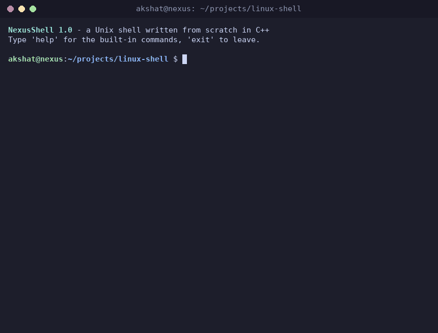
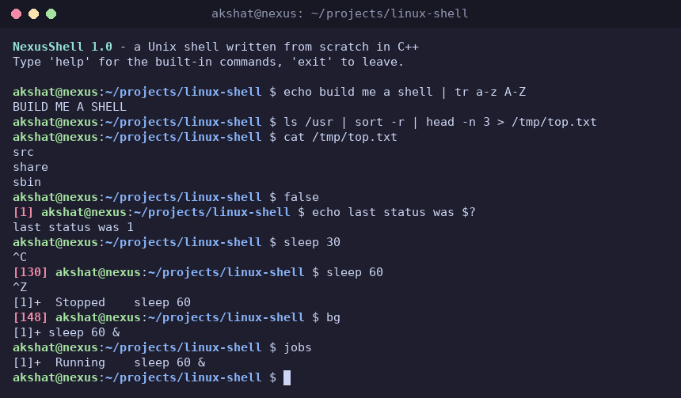

# NexusShell

[](https://github.com/Akshat150305/linux-shell/actions/workflows/ci.yml)

A Unix shell written from scratch in C++17 on raw POSIX system calls. No readline, no ncurses and no wrapper
around bash: process creation, pipes, redirection, job control, signals, line editing and history are all
implemented here, in about 2,900 lines of code.

It was built as an Operating Systems portfolio project, one feature at a time (the commit history follows the
roadmap), so that every piece can be explained from first principles.



*The demo is a real session: `docs/make_demo.py` starts `./nexusshell` on a pseudo-terminal, types into it, and renders
what the terminal shows. Run it yourself to regenerate the GIF and `docs/screenshot.png`.*

## Highlights

- **The core OS interfaces, used directly:** `fork`, `execvp`, `waitpid`, `pipe2`, `dup2`, `open`, `setpgid`, `tcsetpgrp`, `sigaction`, `termios`.
- **Pipelines of any length**, with redirections (`>`, `>>`, `<`, `2>`) and careful file-descriptor hygiene: no leaked descriptors, no hangs on a missing `close()`.
- **Real job control:** every job is its own process group, so Ctrl+C and Ctrl+Z reach the right job and never the shell. `jobs`, `fg`, `bg`, `&`.
- **One `SIGCHLD` reaper, no polling:** finished children are collected the instant they exit, so no zombies; the handler only does async-signal-safe work.
- **A line editor and persistent history** on `termios` raw mode: arrow keys, Ctrl+A/E/K/U/W, `!!`, `~/.nexusshell_history`.
- **A Linux-style prompt** (`user@host:~/dir $`) with a red exit-status indicator and colours that respect `NO_COLOR`.
- **405 automated checks** (unit, end-to-end through a pipe, and on a real pseudo-terminal), also run under AddressSanitizer and UBSan in CI.

## Quick start

```bash
git clone https://github.com/Akshat150305/linux-shell.git
cd linux-shell
make            # builds ./nexusshell
./nexusshell
```

Requirements: Linux (Ubuntu or WSL), `g++` with C++17 support, `make`. Optional: `python3` and `procps` for the
pseudo-terminal tests, `cmake` for the alternative build:

```bash
cmake -S . -B build && cmake --build build     # builds build/nexusshell
ctest --test-dir build --output-on-failure     # runs every test
```

| Command | What it does |
|---|---|
| `make` | build `./nexusshell` |
| `make test` | unit tests: lexer, parser, job table, history, prompt (no terminal needed) |
| `make smoke` | end-to-end checks: feeds scripts to the real binary through a pipe |
| `make test-pty` | end-to-end checks on a real pseudo-terminal: Ctrl+C, Ctrl+Z, arrow keys, prompt, colours |
| `make check` | everything above |
| `make asan` | `make check` again, built with AddressSanitizer and UBSan (rebuild with `make` afterwards) |
| `make clean` | remove build outputs |

## Features

| Area | What works |
|---|---|
| **Core** | interactive loop; any external command through `fork` + `execvp` + `waitpid`; `$PATH` search; shell exit statuses (`126` not executable, `127` not found, `128+N` killed by signal N) |
| **Built-ins** | `cd` (`cd`, `cd -`, `PWD`/`OLDPWD`), `pwd`, `echo [-n]`, `exit [n]`, `clear`, `help`, `history [N\|-c]`, `export`, `jobs`, `fg`, `bg` |
| **Parsing** | tokenizer with single and double quotes, backslash escapes, `$VAR`, `${VAR}`, `$?`, `$$`, `~`; clear syntax errors (status 2) |
| **Redirection** | `>`, `>>`, `<`, `2>`, in any order, also on built-ins (the shell's own descriptors are saved and restored) |
| **Pipes** | `a \| b \| c` of any length; redirections combine with pipes; the status is the last stage's |
| **Process control** | `cmd &`, `jobs`, `fg`, `bg`, Ctrl+C (`SIGINT`), Ctrl+Z (`SIGTSTP`), `SIGCHLD` reaping, a warning before leaving with stopped jobs |
| **History** | in-memory list, `~/.nexusshell_history` (mode 0600, last 1000 commands), Up/Down recall, `!!` `!N` `!-N` `!text` |
| **Line editing** | Left/Right, Home/End, Delete, Backspace, Ctrl+A/E/B/F/K/U/W/L/D |
| **Terminal UI** | banner, `user@host:dir $` prompt, red `[N]` after a failed command, colours (off with `NO_COLOR`), grouped `help`, uniform `nexus: ...` error messages |

## Example session



The screenshot shows a pipeline (`echo ... | tr`), a pipeline with a redirection (`ls /usr | sort -r | head -n 3 > file`),
the red `[1]` after `false`, `$?`, Ctrl+C on `sleep 30` (`[130]`), Ctrl+Z on `sleep 60` (`[148]`, `Stopped`), `bg` and
`jobs`. The demo account is called `akshat` on a host called `nexus`; your prompt shows your own user and host.

## More examples

These transcripts were recorded in script mode (stdin is a pipe), so the prompt is the fixed text `nexus> `.

```text
nexus> echo "hello   world" 'single $HOME' $HOME
hello   world single $HOME /home/akshat
nexus> export GREETING="hello world"
nexus> /bin/echo "$GREETING!"
hello world!
nexus> cd ~/projects
nexus> pwd
/home/akshat/projects
nexus> cd -
/home/akshat
nexus> echo "oops
nexus: syntax error: unterminated double quote
nexus> echo $?
2
nexus> ls /tmp > listing.txt
nexus> ls /nonexistent 2> errors.txt
nexus> cat errors.txt
ls: cannot access '/nonexistent': No such file or directory
nexus> echo "line one" > notes.txt
nexus> echo "line two" >> notes.txt
nexus> sort < notes.txt > sorted.txt
nexus> cat sorted.txt
line one
line two
nexus> echo ">" is just text
> is just text
nexus> ls /bin | head -3
2to3-3.11
X11
Xvfb
nexus> printf "b\na\nc\na\n" | sort | uniq -c | sort -rn
      2 a
      1 c
      1 b
nexus> seq 1 100 | grep 5 | wc -l
19
nexus> cat < notes.txt | sort | head -1 > first.txt
nexus> false | true
nexus> echo $?
0
nexus> cd /tmp | cat
nexus> pwd
/home/akshat/projects
nexus> sleep 30 &
[1] 4242
nexus> sleep 5 | cat &
[2] 4244
nexus> jobs
[1]-  Running    sleep 30 &
[2]+  Running    sleep 5 | cat &
nexus> sh -c 'exit 3' &
[3] 4250
nexus>
[3]+  Exit 3     sh -c 'exit 3'
nexus> history
    1  echo "hello   world" 'single $HOME' $HOME
    ...
nexus> exit 3
```

## Architecture

Each stage of the pipeline below is its own module with one job. The lexer, parser, history rules and prompt
formatting are **pure functions** (text in, data out), which is what makes them unit-testable without a terminal.

```text
 keyboard
    │  raw bytes (termios raw mode)
    ▼
 input.cpp ──► history.cpp ──► lexer.cpp ──► parser.cpp ──► executor.cpp ──► kernel
 line editor   "!!" expansion   tokens        Pipeline        fork / exec / pipe
               + history file                 (argv + redirs)       │
                                                                    ├──► builtins.cpp   cd, export, ... (run in the shell process)
                                                                    ├──► redirect.cpp   open / dup2 / close
                                                                    └──► jobs.cpp       job table: running, stopped, done
                                                                              ▲
                                              signals.cpp ────────────────────┘
                                              SIGCHLD reaper, process groups, terminal ownership

 prompt.cpp ◄── exit status, user, host, cwd (drawn before every read)
```

### How a line is processed

```text
"sort < in.txt | head -2 > out.txt &"
   │
   ▼ read_line()         line editor (input.cpp); history_expand() handles !! (history.cpp)
   ▼ tokenize()      ──► sort OP(<) in.txt OP(|) head -2 OP(>) out.txt OP(&)         (lexer.cpp)
   ▼ parse_pipeline()──► command 1: argv {sort}       redirections {0 < in.txt}
   │                     command 2: argv {head, -2}   redirections {1 > out.txt}      background = true   (parser.cpp)
   ▼ execute()                                                                        (executor.cpp)
   │
   ├─ ONE built-in, no pipe, not background ──► RedirectScope: save fds, redirect, run
   │                                             in the shell process, restore fds
   │
   └─ anything else, with SIGCHLD blocked:
        for each command: pipe2() + fork()
          child:  setpgid (join the job's process group), take the terminal if foreground,
                  reset_child_signals(), dup2 pipe ends onto 0/1, close the rest,
                  apply its redirections, execvp (or run the built-in, then _exit)
          parent: setpgid(child) as well, close its pipe ends, JobTable::add()
        then unblock SIGCHLD, and
          foreground: hand the terminal to the group, sigsuspend() until the job is done or
                      stopped, take the terminal back
          background: print "[1] pid" and do NOT wait

   independently:  the SIGCHLD handler reaps children with waitpid(-1, WNOHANG|WUNTRACED|WCONTINUED)
                   into a fixed array; JobTable::refresh() applies those events to the job table;
                   JobTable::notify() prints "Done" / "Stopped" notices before each prompt
```

The shell forks rather than exec'ing itself, so it survives to run the next command.
Exit statuses follow shell convention:

| Status | Meaning |
|---|---|
| `0` | success |
| `1..255` | command's own exit code |
| `2` | syntax error (for example an unterminated quote) |
| `126` | found but not executable |
| `127` | command not found |
| `128 + N` | killed by signal N (`130` = Ctrl+C, `139` = SIGSEGV, `148` = stopped by Ctrl+Z) |

### System calls at a glance

| Concept | Calls | Where |
|---|---|---|
| Processes | `fork`, `execvp`, `waitpid`, `_exit` | `executor.cpp`, `signals.cpp` (the reaper) |
| File descriptors and redirection | `open` (`O_CLOEXEC`), `dup2`, `close`, `fcntl` (`F_DUPFD_CLOEXEC`) | `redirect.cpp`, `executor.cpp` |
| Pipes | `pipe2` (`O_CLOEXEC`) | `executor.cpp` |
| Working directory and environment | `chdir`, `getcwd`, `setenv`, `getenv` | `builtins.cpp`, `lexer.cpp` |
| Signals | `sigaction`, `sigprocmask`, `sigsuspend`, `ppoll`, `kill` | `signals.cpp`, `jobs.cpp`, `input.cpp` |
| Job control and the terminal | `setpgid`, `tcsetpgrp`, `tcgetpgrp`, `tcgetattr`, `tcsetattr` | `signals.cpp`, `jobs.cpp`, `input.cpp` |
| Persistence | `open` (`O_APPEND`), `write` | `history.cpp` |
| Identity | `getpwuid`, `gethostname`, `isatty` | `prompt.cpp`, `main.cpp` |

### Project layout

| File | Responsibility |
|---|---|
| `main.cpp` | The shell loop: report jobs, read a line, expand `!`, record history, tokenize, parse, execute |
| `input.h` / `input.cpp` | `read_line()`: the line editor (raw-mode `termios`, arrow keys, history recall); plain `getline` when stdin is not a terminal |
| `prompt.h` / `prompt.cpp` | The prompt (`user@host:dir $`, `~` for $HOME, red `[N]` after a failure), the welcome banner, colour policy. Formatting is a pure function |
| `history.h` / `history.cpp` | In-memory history rules, the persistent file (`O_APPEND`), `!!` / `!N` / `!text` expansion. Pure functions |
| `lexer.h` / `lexer.cpp` | `tokenize()`: quotes, escapes, `$VAR`, `~`, operators (`< > >> 2> \| &`), syntax errors. A pure function |
| `parser.h` / `parser.cpp` | `parse_pipeline()`: tokens become a `Pipeline` of `Command`s (argv + redirections each) plus a `background` flag |
| `executor.h` / `executor.cpp` | `execute()`: runs built-ins in-process, forks one child per stage into its own process group, wires `pipe()`s, hands over the terminal, waits through the job table |
| `jobs.h` / `jobs.cpp` | `JobTable`: foreground, background and stopped jobs as process groups; `fg`/`bg` logic; `Done`/`Stopped` notices |
| `signals.h` / `signals.cpp` | `SIGCHLD` handler (the single reaper), `SIGINT`/`SIGTSTP` policy, process groups and terminal ownership (`tcsetpgrp`), terminal modes |
| `redirect.h` / `redirect.cpp` | `open`/`dup2`/`close` redirection: `apply_redirections()` for children, `RedirectScope` for built-ins |
| `builtins.h` / `builtins.cpp` | `ShellState`, built-in dispatch table, the built-in commands (incl. `jobs`, `fg`, `bg`) |
| `tests/` | unit tests (`test_*.cpp`), `smoke.sh`, and pseudo-terminal tests (`test_job_control.py`, `test_line_editing.py`, `test_ui.py`) |
| `docs/` | `make_demo.py` (records the demo), `screenshot.png`, `demo.gif`, `INTERVIEW_NOTES.md` |
| `Makefile`, `CMakeLists.txt`, `.github/workflows/ci.yml` | build rules (either build system), continuous integration |

## Testing

`make check` builds the shell and runs every suite. The same command runs in CI on every push, followed by
`make asan`, which rebuilds everything with AddressSanitizer and UBSan and runs the whole suite again.

| Suite | How it runs the shell | Checks |
|---|---|---|
| `tests/test_lexer.cpp` | no shell: the pure function | 114 |
| `tests/test_parser.cpp` | no shell: the pure function | 83 |
| `tests/test_jobs.cpp` | no processes: raw `wait()` statuses are fed to the job table | 35 |
| `tests/test_history.cpp` | no shell: add rules, file I/O, `!` expansion | 55 |
| `tests/test_prompt.cpp` | no shell: prompt formatting | 21 |
| `tests/smoke.sh` | the real binary, scripts through a pipe, output compared | 30 |
| `tests/test_job_control.py` | the real binary on a **pseudo-terminal**; types real Ctrl+C / Ctrl+Z | 20 |
| `tests/test_line_editing.py` | pseudo-terminal: arrow keys, editing, history, persistence | 26 |
| `tests/test_ui.py` | pseudo-terminal: prompt, status indicator, colours, banner, `help`, error format | 21 |

Why a pseudo-terminal? Ctrl+C, Ctrl+Z and arrow keys only exist when the shell has a controlling terminal. The Python
tests create one with `pty.fork()`, type into it like a person, and read back what it prints. A test never touches your
real `~/.nexusshell_history`: it sets `NEXUSSHELL_HISTFILE` to a throwaway file.

Beyond passing, the tests were checked to be able to fail ("mutation checks" during development): deleting the parent's
`close(write_end)` makes `echo hi | cat` hang; deleting the reaping call leaves 30 zombies instead of 0; deleting the
`setpgid` calls fails 9 of the pseudo-terminal tests; skipping the terminal restore in the line editor fails the
"terminal is back to normal while a command runs" test.

The per-feature checklists (what each phase verified) are at the end of this file.

## Troubleshooting

| Symptom | Cause and fix |
|---|---|
| `make: g++: Command not found` | Install a compiler: `sudo apt install build-essential`. Any `g++` with C++17 support works (CI uses GCC 13) |
| The prompt is just `nexus> `, there is no banner, and `fg` says `no job control` | Standard input is not a terminal (a pipe, a file, or an IDE panel without a tty). This is the deliberate script mode. Run `./nexusshell` from a real terminal |
| `command not found` (status 127) for a program in the current directory | `.` is not in `$PATH`; run it as `./program` |
| `Permission denied` (status 126) | The file exists but is not executable: `chmod +x file` |
| History is not saved | It is only saved when stdin is a terminal. Also check that `$HOME` is set and writable; an unwritable history file is skipped silently. Set `NEXUSSHELL_HISTFILE=/path` to choose another file |
| Raw `\033[1;32m` text, or garbled colours | The terminal does not understand ANSI colours. Start with `NO_COLOR=1 ./nexusshell` (colours also switch off when `TERM=dumb`) |
| Typed text is invisible, or the terminal behaves oddly after the shell was killed with `kill -9` | `SIGKILL` cannot be caught, so the line editor could not restore the terminal. Run `stty sane` (or `reset`) |
| Ctrl+Z at the prompt does nothing | By design: the shell ignores it for itself. Ctrl+Z stops the running job; `fg` or `bg` resumes it |
| `There are stopped jobs.` when leaving | Resume them with `fg` / `bg`, or type `exit` (or press Ctrl+D) a second time to leave; stopped jobs then get `SIGHUP` |
| `&&` or `2>&1` give a syntax error; `;` and `$(...)` seem to do nothing; `FOO=1 cmd` is "command not found" | These are not implemented (see Known limitations). `&&` and `2>&1` are rejected with an error; `;` and `$(...)` are not operators, so they reach the command as ordinary text (`echo a; echo b` prints `a; echo b`). Use separate lines, `export FOO=1`, and `cmd 2> file` |
| `make test-pty` fails to start, or `ps`/`pkill` not found | The pseudo-terminal tests need `python3` and `procps` (`sudo apt install python3 procps`). `make test` and `make smoke` do not need Python |
| `./nexusshell` is missing after `make asan` | `make asan` cleans up after itself; run `make` to build the normal binary again |

## Known limitations

This is a learning shell, not a bash replacement. Deliberately out of scope:

- **No shell language:** no `&&`, `||`, `;`, `( )`, `$( )`, `if`/`for`/functions, and no `NAME=value` assignment (use `export NAME=value`). `&&` and `2>&1` are rejected with a syntax error; `;` and `$( )` are **not operators**: they reach the command as ordinary text (`echo a; echo b` prints `a; echo b`)
- **Redirection:** no `2>&1`, `1>`, `2>>`, `&>` or here-documents (`<<`); a pipeline stage or background line with only redirections (`> f | cat`, `> f &`) is rejected
- **Expansion:** no globbing (`*.cpp`), `~user`, `$1`-style parameters or `#` comments; no word splitting of expanded values (after `export X="a b"`, `echo $X` passes one argument, as in zsh)
- **Job control:** no `wait` or `kill %1` (the external `kill` takes PIDs); no `%name` job specs; running background jobs are not sent `SIGHUP` when the shell exits
- **Line editing:** byte-based (ASCII), so multi-byte UTF-8 characters can misplace the cursor; a line longer than the terminal width repaints imperfectly; no Tab completion, no Ctrl+R search, no `!` inside a line, no `$HISTSIZE`
- **Prompt:** not configurable (no `$PS1`); the hostname is not shortened at the first dot

## Roadmap

All phases are complete; the commit history follows them (`feat: add interactive shell loop`, `feat: execute external commands`, ..., `feat: improve terminal UI`, then the test, CI and documentation commits).

- [x] Phase 1: interactive shell loop
- [x] Phase 2: external command execution (`fork` / `execvp` / `waitpid`)
- [x] Phase 3: built-in commands (`cd`, `pwd`, `echo`, `exit`, `clear`, `help`, `history`, `export`)
- [x] Phase 4: lexer (quotes, escapes, `$VAR`, `~`)
- [x] Phase 5: I/O redirection (`>`, `>>`, `<`, `2>`)
- [x] Phase 6: pipes
- [x] Phase 7: background jobs (`&`, `jobs`)
- [x] Phase 8: signals and job control (Ctrl+C, Ctrl+Z, `SIGCHLD`, `fg`, `bg`)
- [x] Phase 9: history (persistent file, arrow-key recall, `!!`) and a small line editor
- [x] Phase 10: Linux-style prompt and UI (`user@host:dir $`, status indicator, banner, colours)
- [x] Phase 11: testing, CI, documentation and polish

Ideas for the future: `&&` / `;` command lists, `$( )`, globbing, Tab completion, `wait`, a configurable prompt.

Interview preparation: see [docs/INTERVIEW_NOTES.md](docs/INTERVIEW_NOTES.md).

## Design notes

One section per phase: the concept, the design, and the edge cases that shaped it. These are the parts to read before an interview.

### Parsing rules (Phase 4)

Programs never see quotes: `echo "a b"` reaches `echo` as two arguments, `echo` and `a b`.
The shell's lexer does that work before `execvp`.

| Syntax | Meaning | Example (input → argument) |
|---|---|---|
| space / tab (unquoted) | separates words | `ls   -l` → `ls`, `-l` |
| `'...'` | everything literal, no escapes, no expansion | `'a $HOME'` → `a $HOME` |
| `"..."` | spaces kept; `$VAR` expands; `\"` `\\` `\$` are escapes | `"hi $USER"` → `hi akshat` |
| `\x` (unquoted) | next character is literal | `a\ b` → `a b` |
| `$VAR`, `${VAR}` | environment variable; unset becomes empty | `$HOME/src` → `/home/akshat/src` |
| `$?`, `$$` | last exit status, shell PID | `echo $?` → `0` |
| `~` at word start | home directory (`~` and `~/path` only) | `~/src` → `/home/akshat/src` |

Details worth knowing:

- Quoted and unquoted pieces join into one word: `ab"cd"'ef'` is the single word `abcdef`.
  This is why `export MSG="hello world"` works.
- `""` is a real empty argument and is kept. An unquoted `$UNSET` expands to nothing and
  the word disappears, so `ls $UNSET` runs plain `ls`.
- A `$` that starts no valid reference (`$`, `$ x`, `$1`) stays a literal `$`.
- Syntax errors (unterminated quote, trailing backslash, malformed `${...}`) print a message,
  skip the command and set the status to 2.

### I/O redirection (Phase 5)

Every process has a table of file descriptors: `0` is stdin, `1` is stdout, `2` is stderr.
Programs just read fd 0 and write fd 1 without knowing where those lead. Redirection works
because the shell rewires the table **before** the program starts, and `exec` keeps open
descriptors:

```
child after fork():
    fd = open("out.txt", O_WRONLY|O_CREAT|O_TRUNC, 0666)    // say fd 3
    dup2(fd, 1)          // fd 1 now points at out.txt
    close(fd)            // drop the spare copy
    execvp("ls", ...)    // ls writes to fd 1, unaware it is a file
```

The parent shell's descriptors are never touched, because the rewiring happens in the child.

| Operator | Descriptor | `open()` flags |
|---|---|---|
| `> file` | 1 (stdout) | `O_WRONLY \| O_CREAT \| O_TRUNC` (empties the file) |
| `>> file` | 1 | `O_WRONLY \| O_CREAT \| O_APPEND` |
| `< file` | 0 (stdin) | `O_RDONLY` |
| `2> file` | 2 (stderr) | same as `>` |

Rules and details:

- Redirections apply **left to right**: `cmd > a > b` creates both files and `b` wins.
- They may appear anywhere in the line (`> out echo hi`) and need no spaces (`echo hi>out`).
- `2>` is an operator only at the **start of a word**: `echo 2 > f` writes `2`, `echo a2>f` writes `a2`,
  and `echo 2>f` redirects stderr.
- Operators are recognized only when **unquoted**: `echo ">"` prints a character.
- If a redirection fails (missing directory, target is a directory), the command is **not run**
  and the status is 1.
- A line with only redirections (`> file`) creates or truncates the file, as in bash.
- **Built-ins have no child to rewire**, so `RedirectScope` saves the shell's descriptor with
  `fcntl(F_DUPFD_CLOEXEC)`, redirects, runs the built-in, flushes output, then restores it with `dup2`.
  Skipping the flush or the restore would send output to the wrong place.
- Files are opened with `O_CLOEXEC`, so a spare descriptor can never leak into a program.

### Pipes (Phase 6)

`pipe(fd)` creates a kernel buffer (about 64 KB on Linux) with two ends: `fd[0]` is the
**read end** and `fd[1]` is the **write end**. For `a | b | c` the shell makes a pipe per `|`,
forks one child per command, and uses `dup2` to wire stdout of each stage to the write end and
stdin of the next stage to the read end:

```
a ──fd 1──► [pipe 1] ──fd 0──► b ──fd 1──► [pipe 2] ──fd 0──► c
```

All stages run **at the same time**. The pipe is the flow control: a writer blocks when the buffer
is full and a reader blocks when it is empty.

**The classic bug: unclosed pipe ends.** A reader sees end-of-file only when *every* copy of the
write end is closed. If the parent (or any other child) keeps a copy, the reader waits forever.
So every process closes every pipe descriptor it does not use:

| Process | Closes |
|---|---|
| Child | the original pipe fds, right after `dup2` copied the needed ones onto 0 and 1 |
| Parent | its copies of both ends, right after each `fork()` |

Pipes are created one at a time, so the parent holds at most two pipe ends, and `pipe2(O_CLOEXEC)`
closes any stragglers on `exec` as a safety net.

Rules and details:

- **Status:** a pipeline's exit status is the **last** command's (bash default): `false | true` is 0.
- **Early-exiting reader:** `yes | head -1` finishes because the next `write()` by `yes` gets **SIGPIPE**.
- **Stderr is not piped:** `ls /nonexistent | wc` prints the error on the terminal.
- **Built-ins in a pipeline run in a child**, as in bash. `echo hi | cat` forks for `echo`, and
  `cd /tmp | cat` does **not** change the shell's directory. A single built-in with no pipe still
  runs in the shell process.
- **Redirections win over pipes:** `echo hi > f | cat` writes to `f` and leaves `cat` an empty input;
  `echo x | cat < f` reads from `f`.
- Every stage must be a command: `| cat`, `echo |`, `a || b` and `> f | cat` are syntax errors (status 2).
- The parent waits for every child, so there are no zombies, and flushes its output before forking,
  so children never print buffered text a second time.

### Background jobs (Phase 7)

Running in the background is just **not waiting**: for `sleep 30 &` the shell does the same
`fork()` + `execvp()` as usual but skips `waitpid()` and returns to the prompt.

The bookkeeping exists because of **zombies**. When a child exits, the kernel keeps a small record
(PID and exit status) until the parent collects it with `waitpid()`. An exited child that was never
collected is a zombie. Foreground children are collected at once; a background child finishes at an
unpredictable time, so the shell keeps a **job table**:

| Piece | Role |
|---|---|
| Job table (`JobTable`) | numbers each job (`[1]`, `[2]`, ...) and records its PIDs and command text |
| `waitpid(pid, &st, WNOHANG)` | asks "has this child finished?" without blocking: 0 means still running (the Phase 7 mechanism; Phase 8 moved this into the `SIGCHLD` handler, see below) |
| Reporting | before every prompt the shell prints `[1]+  Done   cmd` for finished jobs, then forgets them |
| `jobs` built-in | lists the table: `[1]+  Running    sleep 100 &` |

Phase 7 collected children by polling before each prompt, so a finished job stayed a zombie until then. Phase 8 replaced the
polling with a `SIGCHLD` handler that reaps each child the moment it exits (see "Signals and job control").

Rules and details:

- `&` is accepted only at the **end of the line** (`a & b` is a syntax error; there are no command lists).
- A background **pipeline is one job** (`sleep 1 | cat &`), Done only when every stage has been collected;
  its status is the last stage's.
- The first stage reads **`/dev/null`** as stdin unless you redirect it (`cat < f &`), so a background job
  cannot steal the shell's input (POSIX rule for shells without job control).
- **Built-ins in the background run in a child** (`cd /tmp &` does not move the shell).
- `$?` is 0 after launching, and finished jobs never change the status of foreground commands.
- Notices: `Done`, `Exit N` for a non-zero status, or the signal description (`Killed`, `Terminated`).
  Numbering restarts at 1 when no jobs are left. `+` marks the most recent job and `-` the one before.
- The `JobTable` remembers which process owns it, so `jobs | cat` (where `jobs` runs in a forked child)
  never tries to reap the shell's children.
- Launch lines and notices are printed even when stdin is not a terminal, which keeps behaviour testable.
- `2>&1` now lexes as `2>` `&` `1`, so it still gets the clear "descriptor duplication" error;
  a quoted `"&file"` is an ordinary file name.

### Signals and job control (Phase 8)

**Who receives Ctrl+C?** The terminal driver turns Ctrl+C into `SIGINT` and Ctrl+Z into `SIGTSTP` and sends
it to the **foreground process group** of the terminal, and to nobody else. So the shell gives every job its
own process group and decides which group is in the foreground.

| Mechanism | Role |
|---|---|
| `setpgid(pid, pgid)` | each pipeline becomes one process group; signals sent to `-pgid` reach every stage |
| `tcsetpgrp(tty, pgid)` | makes a group the terminal's foreground group; the shell takes it back after the job ends or stops |
| `SIGINT` handler (no `SA_RESTART`) | Ctrl+C at the prompt interrupts `getline()` and gives a fresh prompt; the shell never dies from it |
| `SIGTSTP`, `SIGQUIT`, `SIGTTIN`, `SIGTTOU` ignored | Ctrl+Z at the prompt does nothing; `tcsetpgrp()` works from a background group |
| `SIGCHLD` handler | the **single reaper**: loops `waitpid(-1, WNOHANG \| WUNTRACED \| WCONTINUED)` and stores `(pid, status)` in a fixed array |
| `WUNTRACED` / `WCONTINUED` | also report children that were **stopped** (Ctrl+Z) or **continued** (`SIGCONT`) |
| `sigsuspend()` | waits for a foreground job without a lost-wakeup race (block `SIGCHLD`, check, then unblock-and-sleep atomically) |
| `SIGCONT` | resumes a stopped group (`fg`, `bg`) |

Races that are handled on purpose:

- **Event before registration:** `SIGCHLD` stays blocked from the first `fork()` until the job is in the table (`SigchldBlock`).
- **Terminal handoff:** both parent and child call `setpgid`, and the child also takes the terminal before `exec`, so it can never read the terminal as a background process (which would stop it with `SIGTTIN`).
- **Inherited signal state:** `SIG_IGN` survives `exec` and a forked built-in never execs, so every child calls `reset_child_signals()` (default handlers, empty mask).
- **Async-signal-safety:** the handler only calls `waitpid()`, writes to a fixed array and restores `errno`. All real work happens later in `JobTable::refresh()`.
- **Terminal settings:** a stopped job's `termios` is saved and restored on `fg`. A normal command that changes the terminal (`stty -echo`) is kept; a job killed by a signal gets the shell's settings back.
- **Redirected stdin:** the shell keeps a private duplicate of the terminal (fd >= 10, close-on-exec), so `fg < /dev/null` still works.

Behaviour:

- Ctrl+C kills the foreground job (whole pipeline); status `130`. Background jobs are not touched.
- Ctrl+Z stops it and prints `[1]+  Stopped     sleep 30`; status `148`. `jobs` lists it, `bg` continues it in the background, `fg` brings it back (prints the command first).
- Job specs: `%1`, `1`, `%%`/`%+` (current), `%-` (previous), or none (current job).
- `exit` or Ctrl+D with stopped jobs prints `There are stopped jobs.` once; the next `exit` leaves and sends them `SIGHUP` + `SIGCONT`.
- A foreground job killed by a signal prints its description (`Killed`, `Terminated`), as bash does.
- Job control is on only when stdin is a terminal. Scripts and pipes (`printf ... | ./nexusshell`) behave like Phase 7: no process groups, `fg`/`bg` say `no job control`, but the `SIGCHLD` reaper is always on, so there are no zombies.
- Finished background jobs are reaped the instant they end (no more zombies until the next prompt); the `Done` notice still appears before the next prompt.

### History and line editing (Phase 9)

**Persistence** is plain file I/O. Every accepted command is appended to `~/.nexusshell_history`
(one line each, mode `0600` because command lines can hold secrets) with `open(O_APPEND)` and a single
`write()`, so a crash loses nothing and two shells can share the file. At startup the last 1000
lines are loaded; an over-long file is trimmed once. `NEXUSSHELL_HISTFILE` overrides the location.
The file is only read and written when **stdin is a terminal**: scripts and pipes never touch it.

**Arrow keys need raw input.** In *canonical mode* the kernel collects a whole line and handles
backspace, so the shell sees nothing until Enter and Up-arrow is just `ESC [ A` text. While reading a
line, `input.cpp` clears two `termios` flags and takes over:

| Flag / call | Role |
|---|---|
| `~ICANON` | deliver every byte at once instead of line by line |
| `~ECHO` | the kernel stops echoing; the editor prints characters itself |
| `ISIG` (kept) | Ctrl+C still raises `SIGINT`; Ctrl+Z is still ignored by the shell |
| `RawMode` (RAII) | puts the old settings back before the command runs, so children never see raw mode |
| `ppoll()` with SIGINT blocked | no lost wakeup if Ctrl+C arrives between "check the flag" and "sleep" (same idea as `sigsuspend` in Phase 8) |
| Escape parsing | `ESC [ A/B/C/D` arrows, `ESC [ H/F` and `ESC [ 1~/4~` Home/End, `ESC [ 3~` Delete; a lone ESC times out after 50 ms |

Keys: Left/Right, Home/End, Backspace, Delete, Up/Down (history; the half-typed line is kept as a draft),
Ctrl+A / E (start / end), Ctrl+B / F (left / right), Ctrl+P / N (up / down), Ctrl+U / K (delete to start / end),
Ctrl+W (delete word), Ctrl+L (clear screen), Ctrl+D (EOF on an empty line, delete otherwise), Ctrl+C (discard the line).

History rules and commands:

- Blank lines and a repeat of the previous command are not recorded; at most 1000 entries are kept.
- `history` lists all, `history N` the last N, `history -c` clears memory **and** the file.
- `!!` (previous), `!N` (command number N), `!-N` (N-th from the end), `!text` (newest command starting with `text`).
  Text after the reference is kept (`!! | wc -l`). The expanded line is printed before it runs.
  A reference is recognised **only at the start of the line** (so quotes and `echo !!` are never touched).
  An unknown event prints `event not found` and runs nothing.
- Numbers are positions in the current list, so they shift when the oldest entries are dropped.

### Prompt and terminal UI (Phase 10)

On a terminal the shell prints a short banner once and then shows a Linux-style prompt:

```text
NexusShell 1.0 - a Unix shell written from scratch in C++
Type 'help' for the built-in commands, 'exit' to leave.

akshat@laptop:~/projects/linux-shell $ false
[1] akshat@laptop:~/projects/linux-shell $ cd /tmp
akshat@laptop:/tmp $
```

| Part | Where it comes from |
|---|---|
| `akshat` | `getpwuid(geteuid())`, the account database. `$USER` can be set to anything, so it is not trusted |
| `laptop` | `gethostname()` |
| `~/projects/linux-shell` | `getcwd()`; the `$HOME` prefix becomes `~`. `/home/akshatx` is **not** under `/home/akshat`. A deleted working directory shows `?` |
| `$` or `#` | `#` when the effective user is root |
| red `[N]` | the exit status of the previous command, shown only when it is not 0 (`[127]` not found, `[130]` Ctrl+C, `[148]` Ctrl+Z). A blank line keeps the previous status |

Colours are ANSI escape sequences (`ESC [ 1;32 m` ... `ESC [ 0 m`). They take no screen columns, which is why the line
editor can repaint the prompt from column 0 without measuring it. Colour is used only when stdout is a terminal,
`NO_COLOR` is unset or empty ([no-color.org](https://no-color.org)) and `TERM` is not `dumb`.

**Scripts stay predictable.** When stdin is not a terminal (pipes, `./nexusshell < file`) there is no banner, no history
file, no colour, and the prompt is the fixed text `nexus> ` (all transcripts in this README that show `nexus> ` come from
script runs). Error messages everywhere share one format: `nexus: <what went wrong>` on stderr.

`help` now has three groups: the built-in commands, the syntax for running programs (pipes, redirection, `&`, quoting),
and the keyboard shortcuts.

### Why built-ins exist

Every process has its own working directory and environment. A forked child gets a
*copy*, so a child can never change its parent's. Commands that change or read the
**shell's own state** must therefore run inside the shell process, with no fork:

| Built-in | Why it must be built-in | Mechanism |
|---|---|---|
| `cd` | changes the shell's own directory | `chdir()`, then `getcwd()` + `setenv("PWD"/"OLDPWD")` |
| `export` | changes the shell's own environment, which children inherit via `execvp` | `setenv()` |
| `exit` | the shell itself must stop | sets `ShellState::running = false` |
| `history` | reads (and `-c` clears) the shell's memory | in-memory `vector<string>`, file `~/.nexusshell_history` |
| `pwd`, `echo`, `help`, `clear` | could be external, built in for speed and portability | `getcwd()`, `cout`, ANSI escape `ESC[H ESC[2J` |

## Per-feature test checklists

What each phase verified, in the order the features were built.

**Phase 1: shell loop**
- [x] Blank line re-prompts without crashing
- [x] `exit` terminates the shell
- [x] Ctrl+D (EOF) terminates cleanly

**Phase 2: external commands**
- [x] Unknown command prints `command not found` (status 127)
- [x] Non-executable file gives `Permission denied` (status 126)
- [x] `false` returns status 1
- [x] A child killed by SIGSEGV returns 139
- [x] Shell keeps running after a failed command
- [x] Shell blocks until a long command (`sleep 1`) finishes
- [x] No zombie processes after many commands

**Phase 3: built-ins**
- [x] `pwd` prints the current directory
- [x] `cd /tmp` changes directory for later commands; `pwd` confirms
- [x] `cd` with no argument goes to `$HOME`; `cd -` goes back and prints the path
- [x] `cd /nonexistent`, `cd file`, `cd a b` print an error and return status 1
- [x] `cd` with `HOME` or `OLDPWD` unset prints an error instead of crashing
- [x] `PWD` and `OLDPWD` are updated and visible to child programs (`env`)
- [x] `echo a   b` prints `a b`; `echo -n` omits the newline
- [x] `exit`, `exit 3`, `exit 256` (becomes 0), `exit -1` (becomes 255)
- [x] `exit abc` prints an error and exits with 2; `exit 1 2` errors and the shell keeps running
- [x] `export FOO=bar` is visible to child programs; values containing `=` and empty values work
- [x] `export 1BAD=x` prints `not a valid identifier` and returns 1
- [x] `export` with no arguments lists the environment, sorted
- [x] `history` lists numbered commands, skips blank lines, includes itself
- [x] `clear` emits the ANSI clear-screen sequence
- [x] `help` lists the built-ins
- [x] External commands still work after built-ins; Ctrl+D keeps the last status

**Phase 4: parsing** (automated lexer cases in `make test`, plus manual checks)
- [x] Extra whitespace and tabs between words are collapsed
- [x] `'...'` keeps everything literal, including `$VAR` and backslashes
- [x] `"..."` keeps spaces, expands `$VAR`, and honours `\"` `\\` `\$`
- [x] Backslash escapes a space, quote, `$` or backslash outside quotes
- [x] Adjacent quoted and unquoted pieces concatenate into one word
- [x] `""` is kept as an empty argument; an unquoted unset `$VAR` disappears
- [x] `$VAR`, `${VAR}`, `$?` and `$$` expand; a lone `$` stays literal
- [x] `~` and `~/path` expand only when unquoted at the start of a word
- [x] Quoted command names work (`"ls" -d /tmp`), as do command names from variables
- [x] An external program receives the exact expected `argv` (verified with a small C program)
- [x] Unterminated quote, trailing backslash and bad `${...}` give a syntax error, status 2, and the shell keeps running
- [x] `history` records the raw line, including lines with syntax errors
- [x] Very long lines with thousands of arguments work (no fixed-size buffers)
- [x] The unit tests fail when the lexer is deliberately broken (checked by mutation)

**Phase 5: redirection** (automated cases in `make test`, plus manual checks)
- [x] `>` creates a file with mode 0644 (under umask 022) and truncates an existing one
- [x] `>>` appends; `<` feeds a file to stdin; `<` and `>` work together (`sort < in > out`)
- [x] `2>` captures stderr only; `> o 2> e` splits stdout and stderr, in either order
- [x] Operators work without spaces (`echo a>f`, `cat<in>out`) and before the command (`> f echo hi`)
- [x] `cmd > a > b` creates both files and the last one wins
- [x] `echo 2 > f` and `echo a2>f` write text; `echo 2>f` redirects stderr
- [x] Quoted or escaped `">"`, `"<"`, `">>"`, `"2>"` are ordinary text
- [x] Built-ins can be redirected (`echo`, `pwd`, `help`, `history`, and `2>` on a failing `cd`)
- [x] The shell's own stdin, stdout and stderr are unchanged afterwards, even after failed redirections
- [x] `help > file` works when the shell's stdout is itself a file (buffered output reaches the right place)
- [x] `> file` with no command creates or truncates it, status 0
- [x] Unwritable or missing targets print an error, skip the command and set status 1
- [x] An operator with no file name is a syntax error (status 2); `2>&1` gives a clear "not supported yet" error and no file named `&1`
- [x] Failed `execvp` messages go to the redirected stderr, as in bash
- [x] No leaked file descriptors in the shell (500 redirected commands) or in child programs (`ls /proc/self/fd` shows only 0, 1, 2)
- [x] No zombie processes after many redirected commands

**Phase 6: pipes** (100 lexer and 58 parser cases in `make test`, plus manual checks)
- [x] Two, three, four, five and 30-stage pipelines produce the right output
- [x] Built-in into external (`echo hi | cat`), external into external, and external into built-in all work
- [x] Large data (`seq 1 200000 | wc -l`) flows through, proving the stages run concurrently
- [x] The reader sees EOF when the writer finishes: no hang (the parent closes its write end)
- [x] `yes | head -3` and `yes | head -100000 | wc -l` terminate (SIGPIPE stops the writer)
- [x] Pipeline status is the last command's (`false | true` is 0, `true | false` is 1, `x | nosuchcmd` is 127)
- [x] Built-ins inside a pipeline run in a child: `cd /usr | cat` and `export V=1 | cat` leave the shell unchanged; `exit 5 | cat` does not exit the shell
- [x] The same built-ins without a pipe still change the shell
- [x] Redirections combine with pipes (`cat < in | sort > out`); an explicit redirect wins over the pipe
- [x] Stderr is not piped; `2>` on one stage captures only that stage's errors
- [x] A failing stage (`nosuchcmd | cat`) does not block the others
- [x] `| cat`, `echo |`, `a || b`, `ls | | wc` and `> f | cat` are syntax errors with status 2
- [x] Quoted or escaped `|` is ordinary text; `echo hi|cat` works without spaces
- [x] Children hold only fds 0, 1, 2 (no stray pipe ends); the shell holds the same 3 fds after 600 pipelines
- [x] The shell's own stdin and stdout are unchanged afterwards
- [x] No duplicated output when the shell's stdout is a file (buffers flushed before fork)
- [x] No zombie processes after 200 pipelines
- [x] Removing the parent's `close(write_end)` makes `echo hi | cat` hang (checked by mutation)

**Phase 7: background jobs** (114 lexer and 83 parser cases in `make test`, plus manual checks)
- [x] `sleep 3 &` returns at once (shell finished in 0.01s) while a foreground `sleep 1` blocks for 1s
- [x] `[1] pid` is printed on launch; `jobs` lists `Running` jobs with numbers and `+`/`-` markers
- [x] A finished job is reported once as `Done`, `Exit N` or the signal name (`Killed`, `Terminated`), then forgotten
- [x] Job numbers restart at 1 when the table is empty
- [x] A background pipeline is one job, still `Running` until its slowest stage ends; status comes from the last stage
- [x] Output and redirections work on background jobs (`seq 1 5 | wc -l > count.txt &`)
- [x] Background stdin is `/dev/null`: `cat &` does not eat the next command; `cat < file &` reads the file
- [x] Built-ins in the background (`cd /usr &`, `export V=1 &`, `exit 9 &`) leave the shell unchanged
- [x] `$?` is 0 after launching; finished jobs do not change a foreground status
- [x] `&`, `& echo`, `a & b`, `a&b`, `a && b`, `ls | &`, `> f &` are syntax errors (status 2); `2>&1` gives the "descriptor duplication" error
- [x] Quoted or escaped `&` is ordinary text; `echo hi > "&file"` creates a file named `&file`
- [x] `jobs | cat` still lists the jobs (a forked copy of the table never reaps the shell's children)
- [x] 25 simultaneous jobs are all listed and all reported
- [x] No zombies once the shell has polled: 0 new zombies after several prompts, 30 without the reaping call (checked by mutation)
- [x] No leaked descriptors in the shell (300 background launches); a background job sees only fds 0, 1, 2

**Phase 8: signals and job control** (`make test`: 114 lexer, 83 parser, 35 job-table cases; `make test-pty`: 20 pseudo-terminal cases)
- [x] Ctrl+C kills `sleep 30` but not the shell; `$?` is 130
- [x] Ctrl+C at an empty prompt (or after a partial line) gives a fresh prompt; the partial line is discarded
- [x] Ctrl+C kills every stage of `sleep 30 | sleep 30 | sleep 30`; no stage is left behind
- [x] Ctrl+C does not touch a background job
- [x] Ctrl+Z stops the job and prints `[1]+  Stopped`; `$?` is 148; `jobs` shows `Stopped`; Ctrl+Z at the prompt is ignored
- [x] Ctrl+Z stops the whole pipeline (every stage in state `T`); `fg` resumes all of it
- [x] `bg` continues a stopped job (`[1]+ sleep 30 &`, then `Running`); `fg` brings it back and Ctrl+C kills it
- [x] `fg` finishes a resumed job normally and returns its real exit status
- [x] `fg`/`bg` errors: `no such job`, `already in background`, `no job control` in scripts
- [x] A finished background job is reaped immediately: 0 zombies with no prompt in between; 25 `true &` leave 0 zombies
- [x] A foreground job killed by a signal prints `Killed` and gives status 137
- [x] `exit` / Ctrl+D with stopped jobs warns once; the second one leaves and the stopped job is gone
- [x] `stty -echo` as a command survives a later Ctrl+Z / `fg` cycle
- [x] `jobs < /dev/null` and `fg < /dev/null` work (the shell keeps a private copy of the terminal)
- [x] Children start with default signal handling (no inherited ignores for INT, QUIT, TSTP, TTIN, TTOU)
- [x] Phase 1-7 behaviour unchanged (redirections, pipes, background, `$?`, no leaked descriptors)
- [x] Removing the `setpgid` calls makes 9 of the 20 pty tests fail (checked by mutation)

**Phase 9: history and line editing** (`make test`: 55 history cases; `make test-pty`: 26 line-editing cases)
- [x] Up/Down walk through earlier commands; Down returns to the half-typed line; Up with an empty history does nothing
- [x] Left/Right, Home/End, Delete, Backspace, Ctrl+A/E/B/F/K/U/W/L/D edit the line; a recalled line can be edited
- [x] A lone ESC, Tab and unknown control keys are ignored (no hang, no garbage)
- [x] Ctrl+C discards the typed line and gives a fresh prompt; 60 Ctrl+C presses at the prompt are never lost
- [x] Ctrl+D on an empty line exits; in the middle of a line it deletes a character
- [x] The terminal is back in normal mode while a command runs (`stty -a` shows `icanon` and `echo`); removing the restore fails the test (checked by mutation)
- [x] Commands are saved to the history file (mode 0600) and a new shell recalls them with Up and lists them with `history`
- [x] `history N`, `history -c` (clears the file too), `history abc` (error)
- [x] Blank lines and consecutive duplicates are not recorded
- [x] `!!`, `!N`, `!-N`, `!text`, `!! | cat`; `event not found` for unknown ones; `echo '!!'` and `echo !!` are untouched
- [x] An over-long history file (1100 lines) is trimmed to 1000 on start
- [x] Scripts and pipes never create or change the history file; an unwritable history path is not fatal
- [x] Phase 1-8 behaviour unchanged (all 20 job-control tests still pass on top of the line editor)

**Phase 10: prompt and terminal UI** (`make test`: 21 prompt cases; `make test-pty`: 21 UI cases)
- [x] The prompt reads `user@host:dir $`; the user comes from `getpwuid`, not from `$USER`
- [x] `$HOME` shows as `~` (also `~/sub`); a sibling such as `/home/akshatx` is not abbreviated; directories with spaces work
- [x] The prompt follows `cd`, `cd -` and `cd` with no argument; a deleted working directory shows `?` and the shell survives
- [x] `#` for root, `$` otherwise
- [x] A failed command adds a red `[N]`; it disappears after a success; a blank line keeps the previous status
- [x] The status is right after Ctrl+C (`[130]`) and Ctrl+Z (`[148]`)
- [x] Colour on a terminal by default; off with `NO_COLOR=1` and with `TERM=dumb`
- [x] The banner prints once on a terminal only
- [x] Scripts get the plain `nexus> ` prompt, no banner and no status indicator
- [x] `help` lists every built-in and the key groups, and every listed built-in exists (never "command not found")
- [x] `clear` sends `ESC [ H ESC [ 2 J`
- [x] Fourteen different failures (unknown command, bad `cd`, unterminated quote, missing redirect target, `fg` without jobs, ...) all print `nexus: ...` on stderr
- [x] Phase 1-9 behaviour unchanged (job-control and line-editing suites pass against the new prompt)
